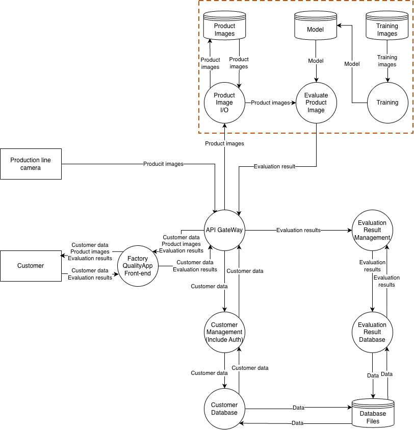
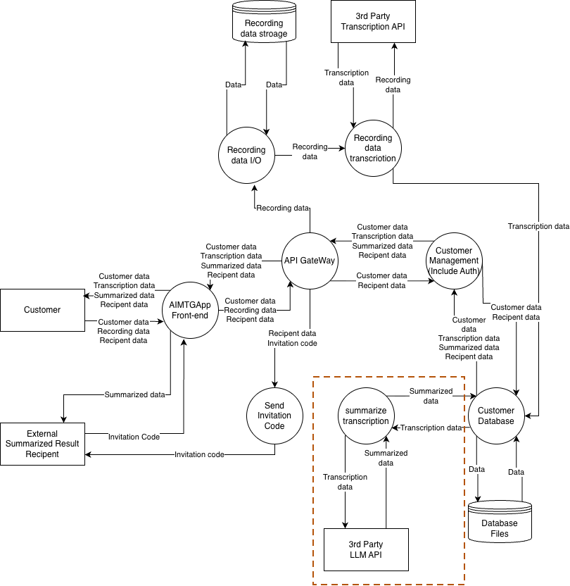
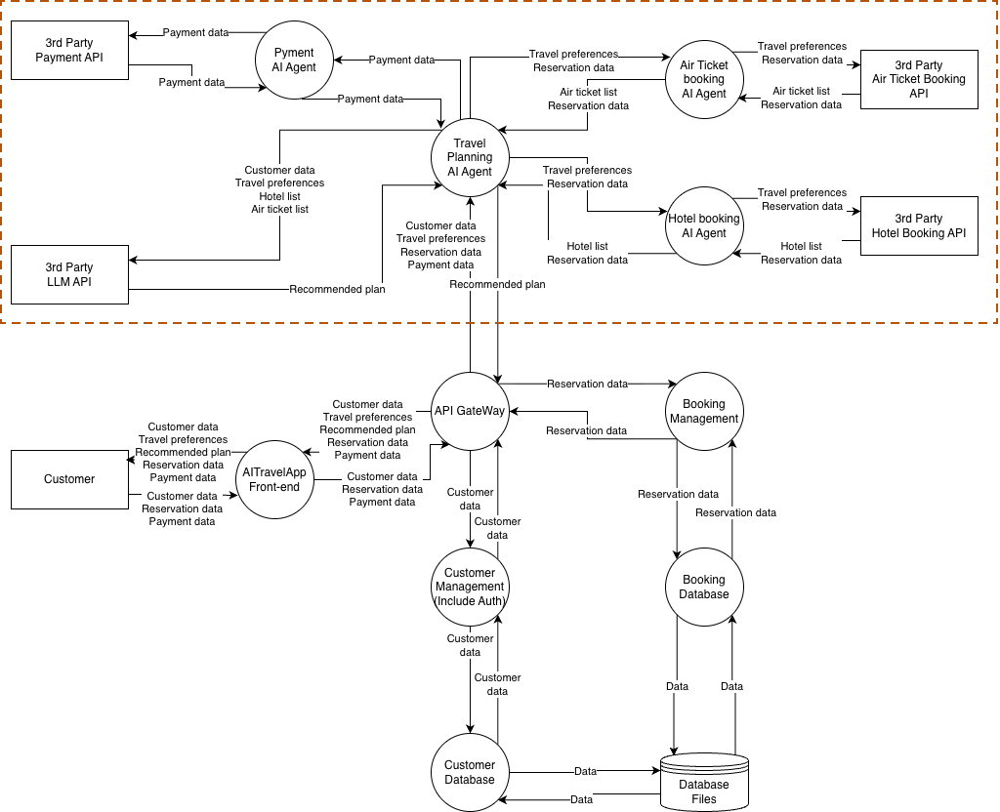

# PHANTOM-B
## 内部にAI機能を有するアプリケーション
### 適用範囲の特定 

### 9つの問い
| | 問い | 脅威 |
| ---- | ---- | ---- |
| P | どうすればプロンプトインジェクションが可能か? | 該当なし |
| H | ハルシネーションが想定を超えたらどうなるか? | ハルシネーション→意図しない・実在しない回答を出力することのため、今回の画像識別で「誤判定」と置き換えるのは妥当という判断。 |
| A | LLMを擬人化していないか? | 擬人化していないか→定性的な信頼をしすぎない、という点において、AI判定への過信と置き換えるのは妥当という判断。 |
| N | いつ、誰に対して、出力を説明・正当化する必要があるか? | 工場や出荷後の製品販売事業者に対して、いつどのタイミングでどんな状態でその判断をしたのか説明できないといけない。不良品が混ざっていた際のリコールなどの対応にも影響。 |
| T | 学習データに偶発的または意図的な品質問題があったらどうなるか? | 誤判定の割合が高くなっていく。全体の品質の低下を招く恐れ。 |
| O | LLMはどのような判断を行い、何に対してどのような制御権を持っているか。それにより意図せず攻撃面が拡大していないか?(「エージェント型AI」のデプロイパターンでは特に重要) | 不良の判断を決めている。 |
| M | 脅威モデリングを含め、SDL(セキュア開発ライフサイクル)のその他のセキュリティエンジニアリングを適切に実施したか? | - |
| - | LLMがアクセスできるデータ、および情報が開示され得る先を制御できているか? | カメラからの映像がそのままアクセスできるデータとなる。制御はできているとみなせる。 |
| B | LLMにはどのようなバイアスがあり、それはこのユースケースにおいて許容できるか? | 学習データセットに不良・良品の偏りがある可能性があり、発生した場合誤検知率の悪化につながり、度合いによっては許容できない。 |

## 外部のLLMを用いたアプリケーション
### 適用範囲の特定 

### 9つの問い
| | 問い | 脅威 |
| ---- | ---- | ---- |
| P | どうすればプロンプトインジェクションが可能か? | ユーザーが、音声データを通じてプロンプトを注入できる可能性。 |
| H | ハルシネーションが想定を超えたらどうなるか? | 発言していない情報が勝手に含まれる。意思決定の捏造などが発生する。 |
| A | LLMを擬人化していないか? | 該当なし |
| N | いつ、誰に対して、出力を説明・正当化する必要があるか? | ユーザーに対して、会議内の意思決定の理由を調査する際、音声データと文字起こしのデータを用いて、要約の背景を説明する。 |
| T | 学習データに偶発的または意図的な品質問題があったらどうなるか? | ハルシネーションリスクが増え、正しくない文字起こしや要約が生成されてしまう可能性がある。 |
| O | LLMはどのような判断を行い、何に対してどのような制御権を持っているか。それにより意図せず攻撃面が拡大していないか?(「エージェント型AI」のデプロイパターンでは特に重要) | 会議の文字起こし内容（会話内容）と、要約・意思決定の内容を決定している。 |
| M | 脅威モデリングを含め、SDL(セキュア開発ライフサイクル)のその他のセキュリティエンジニアリングを適切に実施したか? | - |
| - | LLMがアクセスできるデータ、および情報が開示され得る先を制御できているか? | 認証認可により、他者に対して情報漏洩などがないようにしている。 |
| B | LLMにはどのようなバイアスがあり、それはこのユースケースにおいて許容できるか? | 発言者の属性や関係のない特徴、言葉の選び方により、正しくない要約や意思決定が作成されてしまう可能性。許容できない。 |

## エージェント型AIを用いたアプリケーション
### 適用範囲の特定 

### 9つの問い
| | 問い | 脅威 |
| ---- | ---- | ---- |
| P | どうすればプロンプトインジェクションが可能か? | 第三者 API から返るホテル説明文に埋め込まれた指示が、Travel Planning Agent を経て予約指示に変換される。 |
| H | ハルシネーションが想定を超えたらどうなるか? | 存在しないホテル・便・料金を含む旅行計画が提示される。 |
| A | LLMを擬人化していないか? | 「旅行エージェント」の呼称で顧客が代理店担当者と同等の注意義務を期待する。 |
| N | いつ、誰に対して、出力を説明・正当化する必要があるか? | なぜこのホテルを推薦したか、なぜこの決済が実行されたかを顧客・カード会社に説明できない。 |
| T | 学習データに偶発的または意図的な品質問題があったらどうなるか? | 特定のキーワードに反応して、指示と無関係のホテル・航空券の予約を行うなどの操作が行われる。 |
| O | LLMはどのような判断を行い、何に対してどのような制御権を持っているか。それにより意図せず攻撃面が拡大していないか?(「エージェント型AI」のデプロイパターンでは特に重要) | Payment Agent が Payment data を保持し、LLM の判断で決済を実行する。 |
| M | 脅威モデリングを含め、SDL(セキュア開発ライフサイクル)のその他のセキュリティエンジニアリングを適切に実施したか? | - |
| - | LLMがアクセスできるデータ、および情報が開示され得る先を制御できているか? | 認証・認可により直接的な他者への情報漏えいはケアされている。反面、Customer data・Payment data が LLM API へ送信される。 |
| B | LLMにはどのようなバイアスがあり、それはこのユースケースにおいて許容できるか? | 特定の性質を持つホテルや航空便、行き先を優先する可能性がある。 |
